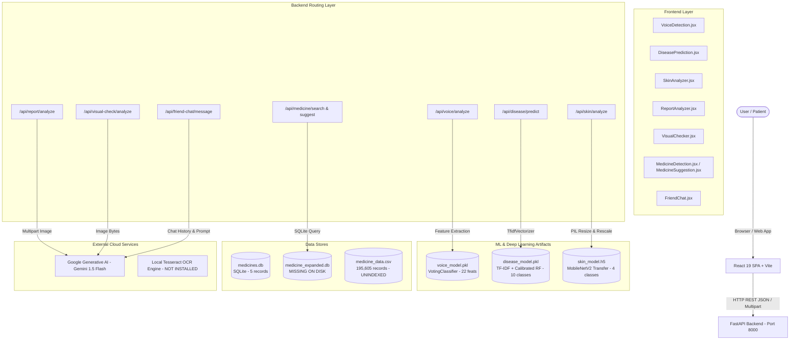
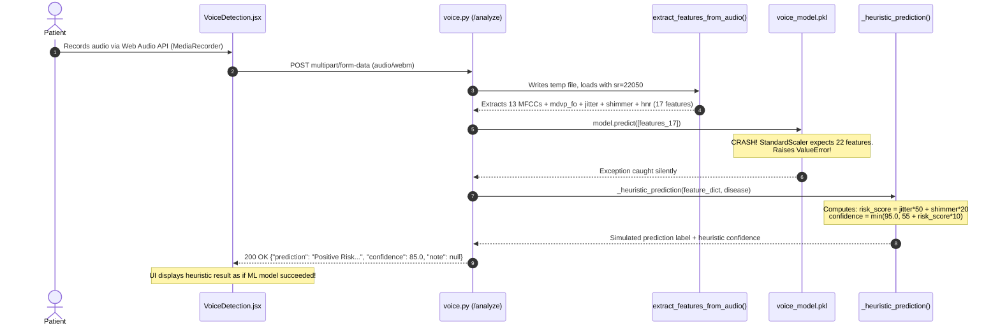
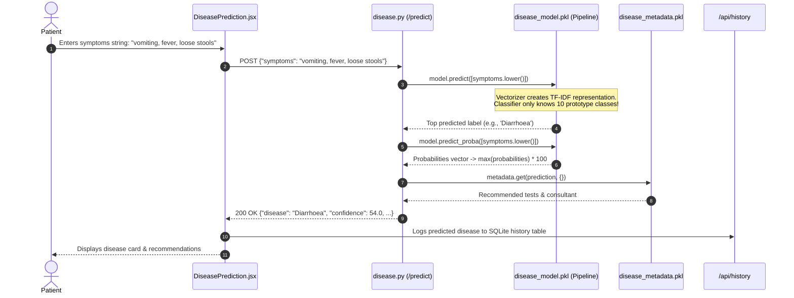
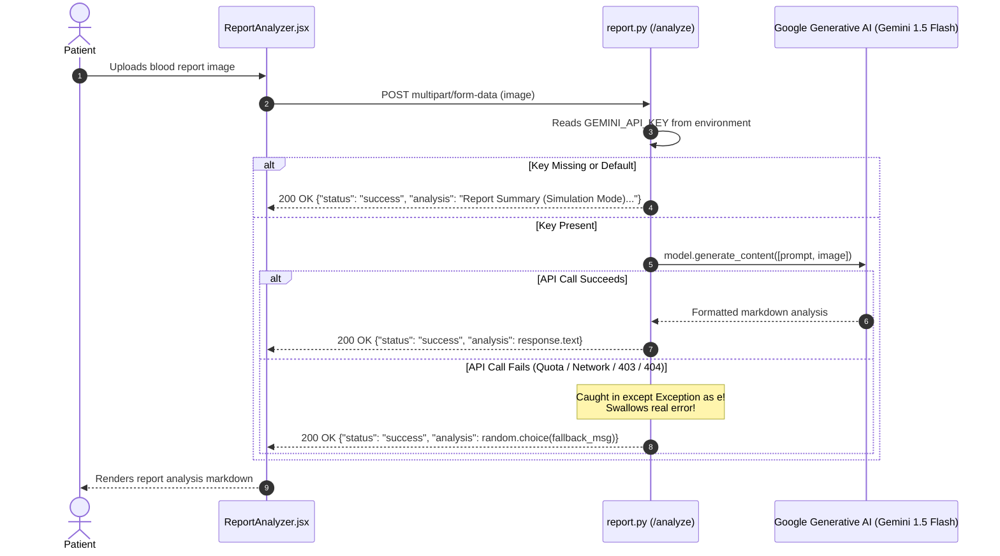
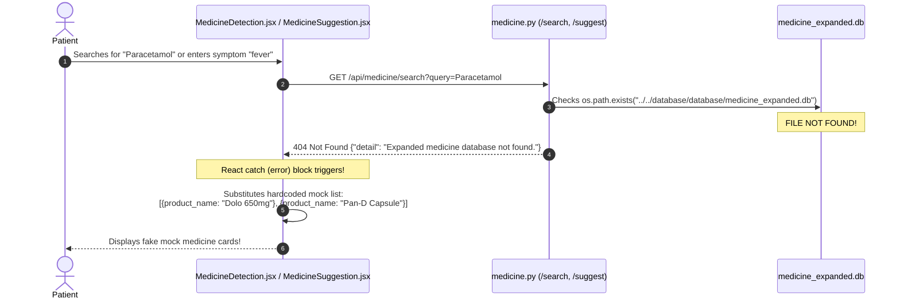
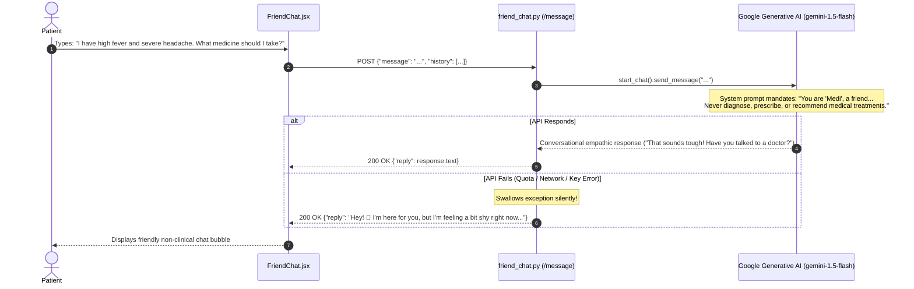

# Medicure — Data Flow & Architecture Dependency Map

**Diagnostic Phase**: Phase 1 System Tracing  
**Date**: October 2026  
**Auditor**: ML Systems Forensic Auditor  

---

## 1. High-Level System Architecture



---

## 2. End-to-End Subsystem Traces

### Subsystem A: Voice Disorder Detection (`/api/voice/analyze`)



---

### Subsystem B: Disease Predictor (`/api/disease/predict`)



> [!WARNING]
> If the user enters an out-of-distribution string (such as `"asdfghjk"` or `"can you tell me a joke"`), the vectorizer yields an all-zero vector, but the classifier still outputs `'Diabates'` with 16.0% confidence because there is no rejection threshold.

---

### Subsystem C: Dermatology AI Skin Analyzer (`/api/skin/analyze`)

```mermaid
sequenceDiagram
    autonumber
    actor User as Patient
    participant UI as SkinAnalyzer.jsx
    participant Route as skin.py (/analyze)
    participant Keras as skin_model.h5 (MobileNetV2)
    participant Logic as Health Score Formula

    User->>UI: Uploads photo of skin rash
    UI->>Route: POST JSON {"image_base64": "data:image/jpeg;base64,..."}
    Route->>Route: Decodes Base64, opens in PIL RGB
    Route->>Route: Resizes to (224, 224), divides by 255.0
    Route->>Keras: model.predict(img_arr[1, 224, 224, 3])
    Keras-->>Route: Softmax probabilities across 4 classes
    Route->>Route: np.argmax(preds[0]) -> detected_class
    Route->>Logic: Calculates health_percentage:<br/>e.g., 30 + ((100 - confidence) * 0.2)
    Logic-->>Route: health_score & canned recommendation
    Route-->>UI: 200 OK {"problem": "Acne Severe", "confidence": 32.7, "health_percentage": 43.5, ...}
    UI-->>User: Renders gauge, detected label, and recommendation
```

---

### Subsystem D: Pathology Report Analyzer (`/api/report/analyze`)



---

### Subsystem E: Medicine Search & Suggestion (`/api/medicine/search & /suggest`)



---

### Subsystem F: AI Friend Chat / Companion Chatbot (`/api/friend-chat/message`)



---

## 3. Data Flow Failure Matrix

| Stage | Subsystem | Failure Mechanism | User-Facing Symptom |
| :--- | :--- | :--- | :--- |
| **Feature Extraction / ML** | Voice Detection | Feature shape mismatch (17 vs 22) crashes model | Fake heuristic risk score with fabricated confidence |
| **Model Ingestion** | Disease Predictor | Obsolete 10-disease artifact deployed instead of 45 | Complete inability to predict 35 conditions; false mapping to prototype classes |
| **Model Classification** | Skin Problem Detector | Class imbalance & heuristic label corruption in training | 0% detection of severe acne; healthy skin flagged as mild acne |
| **Data Persistence** | Medicine Suggestion | `medicine_expanded.db` missing from repository | 404 error converted into hardcoded Dolo/Pan-D mock cards |
| **External API** | Visual Symptom Checker | Non-existent model `models/gemini-2.5-flash` in code | Permanent analysis error banner |
| **External API** | Report & Friend Chat | Silent error swallowing in exception handlers | Canned fallback replies displayed as genuine AI output |
| **Frontend Network** | All Modules | Universal `catch` blocks in React components | Fake clinical results displayed when backend is offline or errors |
