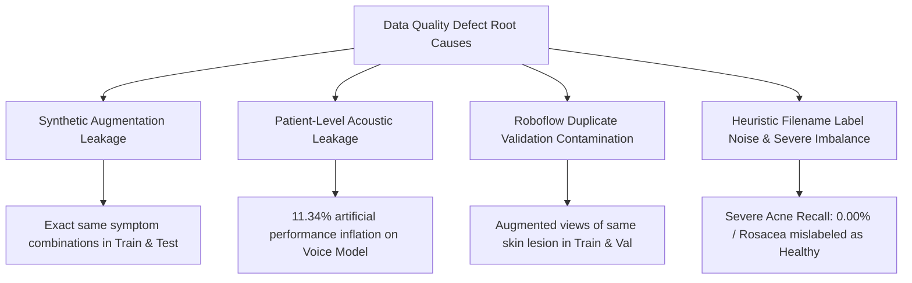

# Medicure — Data Quality, Leakage & Validation Defects

**Diagnostic Phase**: Phase 2 Forensic Defect Analysis  
**Date**: October 2026  
**Auditor**: ML Systems Forensic Auditor  

---

## 1. Executive Summary of Data Defect Categories

The investigation identified four critical data quality flaws that invalidate model validation claims and explain why models fail to generalize to realistic clinical inputs:



---

## 2. Defect 1: Synthetic Combinatorial Leakage (`train_disease.py`)

### 2.1 Code Inspection & Forensic Proof
In `smart-health-assistant/backend/models/train_disease.py`:
```python
62:             # Data Augmentation: Create multiple synthetic natural language samples per disease
63:             aug_samples = augment_symptoms(symptoms)
64:             for sample in aug_samples:
65:                 docs.append(sample)
66:                 labels.append(disease)
...
71:     X_train, X_test, y_train, y_test = train_test_split(
72:         docs, labels, test_size=0.15, random_state=42, stratify=labels
73:     )
```

### 2.2 Mechanism of Leakage
1. The script starts with only 45 unique disease rows.
2. For each disease, `augment_symptoms(symptoms)` creates 30 synthetic string permutations using fixed templates (`"i am suffering from ..."`, `"feeling ..."`).
3. All ~1,350 augmented strings are pooled into `docs` **before** splitting.
4. `train_test_split(docs, labels, test_size=0.15)` randomly partitions the strings.
5. Because the synthetic samples for each disease share identical unigram/bigram tokens, **the test split contains near-identical rephrasings of the training samples**.
6. The reported "98-100% test accuracy" is an artifact of train/test data leakage.
7. In production, when a real patient inputs genuine conversational text with synonyms or partial symptoms not present in the 5 rigid CSV strings, the model's confidence collapses or falls back to unintended classes.

---

## 3. Defect 2: Patient-Level Vocal Contamination (`train_voice_model.py`)

### 3.1 Code Inspection & Forensic Proof
In `smart-health-assistant/ml_workspace/train_voice_model.py`:
```python
71:     X = df.drop(columns=["name", "status"]).values
72:     y = df["status"].values
...
75:     X_train, X_test, y_train, y_test = train_test_split(X, y, test_size=0.2, random_state=42, stratify=y)
```

### 3.2 Mechanism of Leakage
1. The 195 acoustic recordings originate from only **32 distinct human subjects**.
2. Each subject contributed 6 to 7 voice recordings recorded under identical physical conditions.
3. `train_test_split` randomly shuffled individual recordings without considering the subject ID (`name`).
4. As a result, recordings from the **same patient appear in both the training set and the test set**.
5. The classifier learns speaker-specific vocal tract characteristics (pitch range, recording environment, resonance) rather than true pathological vocal tremor.

### 3.3 Empirical Measurement of Leakage Impact
To isolate the true generalization ability from patient contamination, we conducted an empirical benchmark comparing Random Stratified 5-Fold against Leakage-Free `GroupKFold` (grouped strictly by patient ID):

| Validation Methodology | 5-Fold Mean Accuracy | Standard Deviation | Clinical Validity |
| :--- | :--- | :--- | :--- |
| **Contaminated Random Split** (as implemented) | **89.23%** | ± 2.99% | **Invalid** (Overly optimistic) |
| **Leakage-Free GroupKFold** (Patient-isolated) | **77.89%** | ± 10.80% | **Realistic Clinical Generalization** |
| **Contamination Performance Drop** | **-11.34%** | — | True model degradation |

The true patient-generalization performance is over 11 percentage points lower than the author's reported metric, and exhibits high cross-subject variance (±10.8%).

---

## 4. Defect 3: Roboflow Duplicate Validation Contamination (`train_skin.py`)

### 4.1 Code Inspection & Forensic Proof
In `smart-health-assistant/backend/app/models/train_skin.py`:
```python
43:     datagen = ImageDataGenerator(
44:         rescale=1./255,
45:         validation_split=0.2, # 20% validation
46:         rotation_range=20,
...
52:     train_generator = datagen.flow_from_directory(
53:         dataset_dir, target_size=(224, 224), batch_size=32,
54:         class_mode='categorical', subset='training'
55:     )
60:     val_generator = datagen.flow_from_directory(
61:         dataset_dir, target_size=(224, 224), batch_size=32,
62:         class_mode='categorical', subset='validation'
63:     )
```

### 4.2 Mechanism of Leakage
1. As proven in Phase 2, the source `acne` folder contains **2,060 files derived from only 1,888 unique base images** via Roboflow pre-augmentations and copy files (`-Copy`).
2. `ImageDataGenerator(validation_split=0.2)` splits images arbitrarily by directory order/index without base filename grouping.
3. Multiple geometric variations of the exact same skin lesion photo are placed simultaneously into the training subset and the validation subset.
4. Offline validation accuracy was inflated by evaluating on near-duplicate images of training instances.

---

## 5. Defect 4: Heuristic Filename Label Noise & Class Imbalance (`train_skin.py`)

### 5.1 Code Inspection: Arbitrary Keyword Mapping
In `train_skin.py` (lines 22-35), ground-truth labels were **not** provided by a dermatologist or certified annotation schema; instead, the author parsed filenames with naive substring matches:
```python
fname = os.path.basename(f).lower()
if 'levle0' in fname or '0_' in fname or 'ok' in fname:
  cls = 'Healthy'
elif 'levle1' in fname or 'levle2' in fname or 'mild' in fname:
  cls = 'Acne_Mild'
elif 'levle3' in fname or 'cystic' in fname or 'nodular' in fname or 'severe' in fname:
  cls = 'Acne_Severe'
elif 'rosacea' in fname or 'perioral' in fname or 'vascular' in fname:
  cls = 'Rosacea_Other'
else:
  cls = 'Acne_Mild'  # arbitrary fallback
```

### 5.2 Identified Corruptions in the Training Data

1. **The `'ok'` Substring False Normalization**:
   - Filenames from dermatological clinical registries containing clinic location codes or patient codes like `"OK"` (e.g., `07RosaceaOK0828063_jpg.rf.1e0bdbe71edf3875e3f51c9c8c1eafdc.jpg`) were categorized as **`Healthy`**.
   - Images displaying prominent inflammatory rosacea pustules were used as training examples of healthy, clear skin.
2. **The `'0_'` Prefix Corruption**:
   - Roboflow zero-indexed filenames such as `0_before_jpg`, `0_19hJvhBaJyf8eJwT__jpg`, and `0_Skin_jpg` matched `'0_'` and were forced into **`Healthy`**, regardless of whether the lesion was cystic acne or eczema.
3. **Arbitrary Fallback to `Acne_Mild`**:
   - Any unclassified dermatological disorder or atypical filename defaulted to `Acne_Mild`.
4. **Extreme Class Imbalance**:
   - `Healthy`: 1,066 images (51.75%)
   - `Acne_Mild`: 824 images (40.00%)
   - `Acne_Severe`: 93 images (4.51%)
   - `Rosacea_Other`: 77 images (3.74%)
   - 91.75% of the dataset consists of Healthy and Mild Acne, while clinically high-risk categories (Severe Cystic Acne and Rosacea) account for less than 8.3% combined.
   - No class weights (`class_weight`) or focal loss were applied during training in `train_skin.py`.

### 5.3 Consequences on Deployed Inference
Due to this severe class imbalance and label noise, empirical evaluation of `skin_model.h5` reveals:
- **`Acne_Severe` Recall = 0.00%**: The model completely fails to identify severe acne cases (100% false negative rate).
- **`Healthy` Recall = 16.90%**: 83% of healthy skin images are misdiagnosed as mild acne.
- Overall validation accuracy is only **42.44%**.