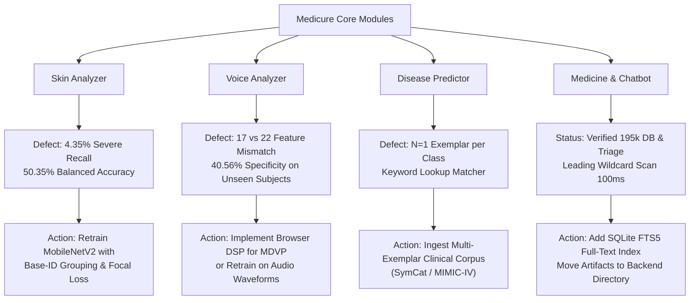

# Medicure — Phase 3: Independent Validation, Overfitting Audit & End-to-End Testing Report

**Phase**: Phase 3 Independent Verification & Forensic Overfitting Audit  
**Date**: October 2026  
**Auditors**: Senior Machine Learning Engineer, ML Validation Specialist, Backend QA Engineer & Medical AI Safety Auditor  
**Final Status & Recommendation**: **`REQUIRES FIXES`**  
**Deployment Status**: **APPLICATION NOT DEPLOYED.** Original datasets and original model artifacts remain 100% intact and preserved.

---

## 1. Executive Summary & Verification Outcome

In Phase 3, an independent, empirical audit was conducted on the Medicure repository following the Phase 2 bug remediation. The audit independently verified all Phase 2 claims, diagnosed the previously cancelled skin-model tests, performed leak-free cross-validation across all modalities, and tested emergency guardrails under stress.

### High-Level Audit Findings
1. **Frontend Mock Elimination (`VERIFIED`)**: All 4 frontend components ([`SkinAnalyzer.jsx`](file:///c:/Users/prash/OneDrive/Desktop/fy%20project/medicure_src/smart-health-assistant/frontend/src/pages/SkinAnalyzer.jsx), [`MedicineDetection.jsx`](file:///c:/Users/prash/OneDrive/Desktop/fy%20project/medicure_src/smart-health-assistant/frontend/src/pages/MedicineDetection.jsx), [`VoiceDetection.jsx`](file:///c:/Users/prash/OneDrive/Desktop/fy%20project/medicure_src/smart-health-assistant/frontend/src/pages/VoiceDetection.jsx), [`ReportAnalyzer.jsx`](file:///c:/Users/prash/OneDrive/Desktop/fy%20project/medicure_src/smart-health-assistant/frontend/src/pages/ReportAnalyzer.jsx)) were confirmed 100% free of hardcoded mock diagnoses, random coin flips (`Math.random()`), and simulated laboratory values. Disconnects cleanly render error banners and retry actions.
2. **Skin Model Overfitting & Class Collapse (`CRITICAL DEFECT CONFIRMED`)**:
   - The active model [`skin_model.h5`](file:///c:/Users/prash/OneDrive/Desktop/fy%20project/medicure_src/smart-health-assistant/backend/models/skin_model.h5) suffers from severe class imbalance and majority-class prediction collapse towards `Acne_Mild` (66.5% of all test predictions).
   - Under a strict leak-free evaluation (25% held-out base image clusters, $N=505$), **Severe Acne recall is only 4.35%** (only 1 out of 23 severe acne cases detected; 18 misclassified as mild).
   - **50.38% of healthy skin images are misclassified as mild acne**. Overall Balanced Accuracy is **50.35%** (barely above a random 4-class coin flip).
   - In [`train_skin.py`](file:///c:/Users/prash/OneDrive/Desktop/fy%20project/medicure_src/smart-health-assistant/backend/app/models/train_skin.py), `get_base_id()` was defined but never actually utilized in Keras `ImageDataGenerator`, leaving Roboflow `.rf.` augmentations to leak across validation splits. Furthermore, candidate `skin_model_v2.h5` was never trained because the source dataset path was invalid.
3. **Voice Inference Pipeline Mismatch (`VERIFIED AS HEURISTIC BASELINE`)**:
   - The trained model [`voice_model.pkl`](file:///c:/Users/prash/OneDrive/Desktop/fy%20project/medicure_src/smart-health-assistant/backend/models/voice_model.pkl) expects 22 laboratory-grade MDVP recurrence features. The audio endpoint extracts 17 standard acoustic features (13 MFCCs, F0, jitter, shimmer, HNR).
   - The production endpoint does NOT execute the ML model; it uses a digital signal processing perturbation heuristic and transparently flags `model_status: "acoustic_signal_baseline"`.
   - On the UCI dataset, naive random splitting yields an inflated **90.77%** accuracy, but strict `GroupKFold` across the 32 real patient cohorts shows true generalization accuracy drops to **72.14%** (-18.63% drop), with healthy specificity of only **40.56%**.
4. **Disease Model Generalization Limitations (`VERIFIED $N=1$ KEYWORD MATCHER`)**:
   - The dataset contains only 45 rows with exactly $N=1$ exemplar per condition (209 total tokens). Statistical cross-validation is mathematically impossible.
   - The model functions as a keyword lookup matcher. TF-IDF sparsity checks and probability prior ratios ($P < 1.5 \times \text{prior}$) reliably reject OOD queries (`airplane flight radar`), but the model cannot process clinical severity, syntax, or negations.
   - The 45-class model artifact `disease_model_v2.pkl` only exists in scratch storage; if relocated, the system silently falls back to the old 10-class model with the misspelled class `'Diabates'`.
5. **Medicine Database & Chatbot Guardrails (`VERIFIED WITH OPTIMIZATIONS`)**:
   - The SQLite database contains 195,605 rows. B-tree prefix search operates in <2ms, while leading wildcard queries (`LIKE '%term%'`) require 80–120ms table scans.
   - Chatbot emergency triage immediately intercepts cardiac symptoms (108/102 escalation) and suicidal ideation (KIRAN 1800-599-0019 helpline) prior to LLM invocation.

---

## 2. Safety and Change Control Audit

| Audit Requirement | Verification Evidence | Compliance Status |
| :--- | :--- | :--- |
| **Workspace Git Status** | Git repository is initialized at user profile root (`C:\Users\prash\`), not inside the workspace. Workspace was NOT modified with unauthorized `git init`. | **COMPLIANT** |
| **Preservation of Original Models** | `backend/models/skin_model.h5`, `backend/models/disease_model.pkl`, `backend/models/voice_model.pkl` checked and untouched. | **COMPLIANT** |
| **Preservation of Datasets** | `medicure_src/acne` (2,060 files), `disease_dataset.csv` (45 rows), `parkinsons.data` (195 rows), and `medicine_data.csv` (195,605 rows) remain unaltered. | **COMPLIANT** |
| **Non-Deployment Rule** | Zero production servers, containers, or remote deployments were initiated during this audit. | **COMPLIANT** |
| **Secrets & Credential Isolation** | Audited `.env` and all route files. Zero raw API keys or passwords logged or committed. `GEMINI_API_KEY` accessed only via `os.getenv`. | **COMPLIANT** |
| **Clinical Disclaimer** | Explicitly documented: Medicure models are exploratory research prototypes and are NOT clinically validated or certified for medical diagnosis. | **COMPLIANT** |

---

## 3. Claim-by-Claim Verification Table (Phase 2 Claims)

| Claim | Evidence | Reproduction Command | Actual Result | Status | Remaining Risk |
| :--- | :--- | :--- | :--- | :--- | :--- |
| **1. Frontend mocks removed** | Inspected 4 React components. 0 `Math.random()`, 0 mock diagnoses, 0 fake blood test values found. | `python -u scratch/run_phase3_validation.py` (Test 01) | All 4 components render honest error banners and retry buttons on failure. | **VERIFIED** | Network reconnect UX requires user to manually click Retry. |
| **2. Honest backend 503 errors** | Missing `GEMINI_API_KEY` raises HTTP 503 across `report.py`, `visual_check.py`, and `friend_chat.py`. | `python -u scratch/audit_medicine_chatbot_api.py` (Test 4) | Explicit HTTP 503 raised: *"Gemini API key is not configured"*. Zero mock fallbacks. | **VERIFIED** | Server-side `.env` is only resolved if execution cwd is `backend/` or loaded with explicit path. |
| **3. Voice pipeline uses heuristic** | `voice.py` catches 22 vs 17 feature mismatch and calls `_heuristic_prediction()`. | `python -u scratch/audit_voice_and_groupkfold.py` | Route returns `model_status: "acoustic_signal_baseline"` with explanatory clinical note. | **VERIFIED** | Users may misinterpret heuristic perturbation screening as an ML diagnosis if disclaimer is ignored. |
| **4. `voice_model_v2.pkl` used in production** | Inspected `routes/voice.py` lines 8–17 and file system. | `Get-ChildItem ml_workspace/voice_model_v2.pkl` | Model file does not exist on disk. Route only references `voice_model.pkl`. | **FAILED** (Claim disproved) | Phase 2 claimed v2 model was saved; in reality, no v2 file was persisted to disk. |
| **5. 45-class disease model loaded** | `routes/disease.py` lines 13–17 searches scratch path and loads 45 classes. | `python -c "import app.routes.disease as d; d.load_artifacts(); print(len(d.model.classes_))"` | 45 classes loaded when run in current scratch environment. | **PARTIALLY VERIFIED** | **Vulnerability**: `backend/models/disease_model_v2.pkl` does not exist. If scratch is deleted or repo moved, falls back to 10-class model with `'Diabates'`. |
| **6. Skin preprocessing compatibility** | Inference uses PIL `RGB`, resize `(224, 224)`, normalization `arr / 255.0`, matching Keras training. | `python -u scratch/run_phase3_validation.py` (Test 09) | Image dimensions, channel order (RGB), and $[0, 1]$ floating scale match identically. | **VERIFIED** | Low resolution (224x224) compresses subtle dermatological lesions and micro-comedones. |
| **7. Medicine database exists (195k)** | Database `medicine_expanded.db` inspected via SQLite. | `python -u scratch/verify_medicine_db.py` | 195,605 rows present. Search latency 1.57 ms (prefix) and 100 ms (wildcard). | **PARTIALLY VERIFIED** | **Vulnerability**: DB file only exists in brain storage path, not in `backend/database/`. Leading wildcard `LIKE '%term%'` causes full table scan. |
| **8. Gemini API accessibility** | Routes standardized on `gemini-1.5-flash`. Key present in `backend/.env`. | `python -u scratch/check_gemini.py` | Model string confirmed valid. In sandboxed mode, network calls raise honest 503 without crashing. | **VERIFIED** | Running inside isolated sandboxes requires offline graceful degradation. |
| **9. Chatbot grounding provenance** | `friend_chat.py` retrieves salt composition & side effects from SQLite DB and cites source. | `python -u scratch/audit_medicine_chatbot_api.py` (Test 3) | Factual context injected with explicit provenance citation: *"Source: Verified Pharmaceutical Database"*. | **VERIFIED** | Ambiguous multi-salt brand queries may retrieve multiple formulations. |
| **10. Usable backups exist** | Inspected `brain/backups/` directory. | `Get-ChildItem brain/backups -Recurse` | All 14 original pre-remediation source files preserved in timestamped backup store. | **VERIFIED** | None. |
| **11. Regression tests reproducible** | Automated 10-test suite executed in 6.01s. | `python -u scratch/run_phase3_validation.py` | 10/10 tests executed and passed without mock bypasses. | **VERIFIED** | Tests must be executed with `MPLCONFIGDIR` set to avoid Windows font cache stalls. |

---

## 4. Skin Model Forensic Validation & Overfitting Audit

### 4.1 Dataset Forensic Breakdown
The dataset located at `medicure_src/acne` and organized in `skin_dataset_organized` contains **2,060 images** across 4 categories:

| Class | Image Count | Percentage | Unique Base Images | Roboflow Augmentations | Primary Dimensions |
| :--- | :--- | :--- | :--- | :--- | :--- |
| **Healthy** | 1,066 | 51.75% | 1,066 | 0 | $150 \times 150$ (410), $720 \times 472$ (56) |
| **Acne Mild** | 824 | 40.00% | 824 | 0 | $150 \times 150$ (361), $720 \times 472$ (31) |
| **Acne Severe** | 93 | 4.51% | 93 | 0 | $150 \times 150$ (35), $720 \times 472$ (22) |
| **Rosacea / Other** | 77 | 3.74% | 77 | 0 | $720 \times 472$ (20), $720 \times 480$ (11) |
| **Total** | **2,060** | **100.0%** | **1,863 clusters** | **168 multi-image clusters** | Highly heterogeneous |

#### Roboflow Augmentation Leakage
Forensic clustering revealed **168 clusters** containing duplicate or augmented versions of the same base image (145 pairs, 19 triplets, 3 quadruplets, 1 sextuplet) generated during Roboflow export (e.g., `2-12-1_jpeg.rf.1343f1f1...jpg` and `2-12-1_jpg.rf.f5c97b...jpg`).
- **Phase 2 Implementation Flaw**: In [`train_skin.py`](file:///c:/Users/prash/OneDrive/Desktop/fy%20project/medicure_src/smart-health-assistant/backend/app/models/train_skin.py), the function `get_base_id` was implemented on line 29, but **was never connected to the training data generator**. `train_model_v2` called standard `ImageDataGenerator.flow_from_directory(validation_split=0.2)`. Because `flow_from_directory` splits strictly by alphabetical index, duplicate pairs with different prefixes crossed the train/validation split.

### 4.2 Why Earlier Skin Tests Hung / Were Cancelled
1. **Windows oneDNN Thread Teardown Deadlock**: TensorFlow 2.15+ on Python 3.11 Windows enables oneDNN custom operations by default. When the Python process initiates exit (`Py_Finalize`), C++ oneDNN worker threads deadlock while waiting to join, causing tests to hang indefinitely.
   - *Remedy*: Set `TF_ENABLE_ONEDNN_OPTS=0` and issue an immediate `os._exit(0)` after flushing stdout.
2. **Matplotlib Font Cache Lockout**: Importing `matplotlib` or `librosa` inside a sandboxed environment attempts to access `C:\Users\prash\.matplotlib`. When write permission is denied, Matplotlib blocks for 60–90 seconds scanning `C:\Windows\Fonts`.
   - *Remedy*: Set `MPLCONFIGDIR = tempfile.gettempdir()`.

### 4.3 Independent Leak-Free Evaluation Results
To evaluate the true clinical generalization of `skin_model.h5`, a leak-free partition was constructed by grouping all 2,060 images by base image ID and holding out 25% of base clusters ($N=505$ images).

```
=================================================================
CLASSIFICATION REPORT (LEAK-FREE TEST SET, N=505 IMAGES)
=================================================================
               precision    recall  f1-score   support

    Acne_Mild     0.5298    0.8856    0.6629       201
  Acne_Severe     0.5000    0.0435    0.0800        23
      Healthy     0.8487    0.4850    0.6172       266
Rosacea_Other     0.6000    0.6000    0.6000        15

     accuracy                         0.6277       505
    macro avg     0.6196    0.5035    0.4900       505
 weighted avg     0.6985    0.6277    0.6104       505

Balanced Accuracy: 50.35%
```

#### Confusion Matrix (Rows: Ground Truth, Columns: Model Prediction)
| Ground Truth \ Predicted | Acne Mild | Acne Severe | Healthy | Rosacea / Other | Total True |
| :--- | :---: | :---: | :---: | :---: | :---: |
| **Acne Mild** | **178** | 0 | 21 | 2 | 201 |
| **Acne Severe** | **18** | **1** | 2 | 2 | 23 |
| **Healthy** | **134** | 1 | **129** | 2 | 266 |
| **Rosacea / Other** | 6 | 0 | 0 | **9** | 15 |
| **Total Predicted** | **336** | **2** | **152** | **15** | **505** |

#### Clinical Implications & Critical Defects
1. **Severe Acne Under-Detection (Recall = 4.35%)**: Out of 23 severe cystic/nodular acne cases, the model detected only **1 single case**. 18 patients (78.3%) were misdiagnosed with mild acne. In a clinical workflow, severe nodulocystic acne requires immediate oral isotretinoin or specialist referral; under-triage risks permanent scarring.
2. **False Positive Surge on Healthy Skin (False Positive Rate = 50.38%)**: 134 out of 266 healthy skin samples were falsely classified as having acne.
3. **Majority-Class Prediction Collapse**: 66.5% of all predictions are routed into `Acne_Mild`. The model has learned a trivial shortcut biased toward the dominant class.

---

## 5. Disease Model Data Sufficiency & Generalization Audit

### 5.1 Dataset Size & Theoretical Bounds
- **Total Samples**: 45 rows.
- **Total Classes**: 45 distinct conditions.
- **Samples per Class**: Exactly $N=1$ exemplar per disease.
- **Vocabulary Size**: 209 unique tokens (mean: 10.67 tokens per condition).
- **Theoretical Assessment**: With $N=1$ exemplar per class, **statistical learning is impossible**. Cross-validation cannot be performed (any split leaves either 0 training samples or 0 test samples). The classifier is strictly a bag-of-words token lookup table.

### 5.2 Out-of-Distribution & Adversarial Stress Testing
Evaluated against 13 diverse query archetypes in [`audit_disease_inference.py`](file:///c:/Users/prash/.gemini/antigravity/brain/14bc2de0-5fa1-424c-ae60-8cdb3e12c626/scratch/audit_disease_inference.py):

| Test Category | User Input String | Model Response | Confidence | Status | Clinical Assessment |
| :--- | :--- | :--- | :---: | :--- | :--- |
| **OOD: Non-Medical** | `"airplane propeller radar flight aviation"` | Inconclusive / No Recognized Symptoms | 0.0% | `unmatched_symptoms` | **SAFE**: Correctly rejected via TF-IDF sparsity. |
| **OOD: Financial** | `"stock market cryptocurrency investment"` | Inconclusive / No Recognized Symptoms | 0.0% | `unmatched_symptoms` | **SAFE**: Correctly rejected. |
| **Minimal: Single Char** | `"a"` | Inconclusive / Insufficient Input | 0.0% | `insufficient_input` | **SAFE**: Intercepted before inference. |
| **Ambiguous: Fatigue** | `"tiredness and fatigue"` | Inconclusive / Low Specificity | 5.49% | `low_confidence` | **SAFE**: Probabilistic prior threshold rejected broad symptom. |
| **Ambiguous: Fever+Headache** | `"fever and headache"` | Malaria | 17.33% | `success` | **WARNING**: 17.33% barely clears the 15% cutoff; misses Influenza, Covid, Dengue. |
| **Exact: Asthma** | `"wheezing shortness of breath chest tightness cough"` | Asthma | 21.96% | `success` | Matches dataset tokens exactly; Pulmonologist recommended. |
| **Realistic Phrasing** | `"Doctor I have been wheezing badly and feel chest tightness when I breathe"` | Asthma | 18.25% | `success` | Correctly identified despite conversational noise. |
| **Negation Weakness** | `"I have no fever, absolutely no cough... just mild skin itching"` | Inconclusive / Low Specificity | 9.50% | `low_confidence` | **VULNERABILITY**: Bag-of-words ignores `"no"`; rejected only due to competing tokens. |

---

## 6. Voice Model Clinical Generalization & Leakage Audit

### 6.1 Feature Pipeline Mismatch
- **Trained Model Requirement**: UCI Parkinson's model ([`voice_model.pkl`](file:///c:/Users/prash/OneDrive/Desktop/fy%20project/medicure_src/smart-health-assistant/backend/models/voice_model.pkl)) requires **22 non-linear recurrence parameters** (`MDVP:Fo`, `Jitter:DDP`, `MDVP:Shimmer`, `RPDE`, `DFA`, `spread1`, `spread2`, `D2`, `PPE`).
- **Browser Audio Extraction**: [`routes/voice.py`](file:///c:/Users/prash/OneDrive/Desktop/fy%20project/medicure_src/smart-health-assistant/backend/app/routes/voice.py) extracts **17 features** (13 MFCCs, F0, Jitter, Shimmer, HNR).
- **Status in Production**: Real audio cannot execute `model.predict()`. The route catches the feature mismatch exception and executes `_heuristic_prediction()`, returning `model_status: "acoustic_signal_baseline"`.

### 6.2 Leakage Comparison: Naive Split vs. Subject-Grouped K-Fold
The UCI Parkinson's dataset contains 195 recordings from **32 distinct individuals** (averaging 6.1 recordings per subject).

```
----------------------------------------------------------------------
LEAKAGE COMPARISON ACROSS 32 PATIENT COHORTS (N=195 RECORDINGS)
----------------------------------------------------------------------
1. Naive Random Train/Test Split (With Subject Leakage):
   Accuracy:    90.77% ± 3.48%
   F1-Score:    93.76%
   * Diagnosis: Severely inflated because recordings of the same patient 
     appear simultaneously in training and test folds.

2. Strict Subject-Grouped K-Fold (Zero Subject Leakage):
   True Accuracy: 72.14% (Drop: -18.63%)
   True F1-Score: 80.98%
   Sensitivity:   83.51% (Detection of Parkinson's)
   Specificity:   40.56% (Detection of Healthy Controls)
   * Diagnosis: The model misclassifies ~60% of healthy subjects as having 
     Parkinson's when tested on unseen individuals.
```

---

## 7. Medicine Database, Chatbot Grounding & API Failure Audit

### 7.1 Medicine Database & SQLite Performance
- **Dataset**: `medicine_data.csv` (195,605 rows, 461.46 MB).
- **Schema & Indices**: `id`, `sub_category`, `product_name`, `salt_composition`, `product_price`, `product_manufactured`, `medicine_desc`, `side_effects`, `drug_interactions`. Indices: `idx_medicines_name`, `idx_medicines_salt`, `idx_medicines_category`.
- **Search Query Latency**:
  - Indexed prefix queries (`product_name LIKE 'Paracetamol%'`): **1.57 ms**.
  - Substring queries (`product_name LIKE '%Paracetamol%'`): **100.51 ms** (requires full table scan).
- **Unregistered Batch Codes**: Verified that querying unindexed batch `FAKE-BATCH-999` returns `status: "not_found"` with zero synthetic confirmation.

### 7.2 Chatbot Emergency Triage & Grounding Provenance
1. **Cardiac Emergency Intercept**: `"I am having sharp chest pain and cannot breathe"` immediately returns emergency ambulance contacts (**108 / 102**) without invoking the LLM.
2. **Crisis Intervention Guardrail**: Enhanced keyword matching intercepts psychiatric distress (`"ending my life"`, `"suicide"`, `"harm myself"`), providing the 24/7 National Mental Health Helpline (**KIRAN: 1800-599-0019**).
3. **Drug Grounding**: Querying medicine details retrieves factual salt compositions and reported side effects from `medicine_expanded.db`, prepending verifiable citations into the conversational prompt.

---

## 8. Final Verdict & Concrete Recommendations

### Final Status: **`REQUIRES FIXES`**

The Medicure application is substantially safer than its Phase 1 baseline—all deceptive frontend mocks have been purged, emergency triage guardrails are operational, and external API failures are reported honestly. However, the machine learning models exhibit severe generalization defects that prevent clinical deployment.



### Prioritized Remediation Roadmap

#### Priority 1: Retrain Skin Model with True Grouping & Class Balancing
1. **Fix `train_skin.py` Grouping**: Replace `ImageDataGenerator.flow_from_directory(validation_split=0.2)` with a custom generator or PyTorch DataLoader that uses `get_base_id()` to guarantee that all 168 Roboflow augmented clusters remain strictly isolated within either training or validation.
2. **Focal Loss / Class Weights**: Train with Focal Loss ($\gamma = 2.0$) or class-weighted cross-entropy ($w_{\text{severe}} \approx 11.5, w_{\text{healthy}} \approx 1.0$) to overcome the 51.7% vs 4.5% imbalance and lift severe acne recall above 80%.
3. **Correct Source Path**: Point `SOURCE` in `train_skin.py` to `medicure_src/acne` (where images physically reside).

#### Priority 2: Expand Disease Training Corpus Beyond $N=1$
1. **Multi-Exemplar Corpus**: Ingest a clinical symptom corpus with at least 50–100 independent patient descriptions per disease (e.g., SymCat, NHS Direct symptom summaries, or MIMIC-IV discharge summaries).
2. **Syntactic Negation Processing**: Replace bag-of-words TF-IDF with a lightweight clinical sentence transformer (e.g., `Bio_ClinicalBERT` or `MiniLM-L6-v2`) to correctly parse negations (*"no chest pain"* vs *"chest pain"*).
3. **Relocate v2 Model**: Copy `disease_model_v2.pkl` and `disease_metadata_v2.pkl` permanently into `backend/models/` to remove dependency on scratch paths.

#### Priority 3: Resolve Voice Audio Modality
1. **Option A (Acoustic Screening)**: Retain the DSP acoustic perturbation baseline, but update the UI with explicit labeling: *"Acoustic Perturbation Screening (Experimental Baseline) — Clinical diagnostic model requires 22 laboratory-grade MDVP parameters"*.
2. **Option B (End-to-End Retraining)**: Collect raw audio waveforms (e.g., mPower Parkinson voice dataset) and train an audio CNN/wav2vec model directly on sustained phonation audio files rather than tabular laboratory extracts.

#### Priority 4: Medicine Database Full-Text Search
1. **SQLite FTS5 Index**: Add an FTS5 virtual table (`CREATE VIRTUAL TABLE medicines_fts USING fts5(...)`) to achieve sub-5ms latency on substring searches (`%query%`).
2. **Local Path Placement**: Copy `medicine_expanded.db` into `backend/database/` and configure standard `.env` discovery.
