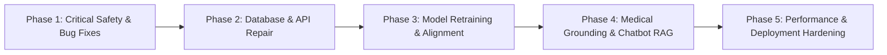

# Medicure — Strategic Remediation & Verification Plan

**Diagnostic Phase**: Phase 10 / 11 Remediation Architecture  
**Date**: October 2026  
**Auditor**: ML Systems Forensic Auditor  

---

## 1. Remediation Sequencing & Phased Roadmap



Remediation must proceed in five strict phases. No model retraining should occur before data leakage is resolved, and no production deployment should proceed while frontend mock fallbacks remain.

---

## 2. Phase-by-Phase Remediation Tasks

### Phase 1: Patient Safety & Frontend Deception Removal (Immediate)
*Goal: Prevent hazardous false medical reassurance and deceptive diagnostic outputs.*

1. **Purge Frontend Mock Catch Blocks**:
   - In `MedicineDetection.jsx`, `VoiceDetection.jsx`, `SkinAnalyzer.jsx`, and `ReportAnalyzer.jsx`, delete all hardcoded mock medical results from `catch` blocks.
   - Replace with standardized UI error state:
     - Toast notification: *"Failed to connect to diagnostic server. Please try again."*
     - Clear retry action button.
     - Never render a calculated confidence score, health percentage, or disease name on network failure.
2. **Eliminate Silent Error Masking in Backend**:
   - In `report.py` and `friend_chat.py`, remove random canned fallback responses in `except Exception`.
   - Return standard HTTP 500/503 errors (`HTTPException(status_code=503, detail="AI Service temporarily unavailable")`).
3. **Fix Broken Gemini Model Identifier**:
   - In `backend/app/routes/visual_check.py`, change `models/gemini-2.5-flash` to `"gemini-1.5-flash"`.

---

### Phase 2: Data Persistence & Feature Schema Repair
*Goal: Fix broken backend endpoints and restore real database capabilities.*

1. **Build `medicine_expanded.db` from `medicine_data.csv`**:
   - Create a dedicated, idempotent ETL script: `backend/database/build_expanded_db.py`.
   - Ingest all 195,605 rows of `medicine_data.csv` into a SQLite database with an **FTS5 full-text search virtual table**.
   - Create disk indices on `product_name`, `salt_composition`, and `sub_category`.
   - Place database at `backend/database/database/medicine_expanded.db`.
   - Verify `/api/medicine/search?query=paracetamol` returns real pharmaceutical records in < 5 ms.
2. **Re-align Voice Inference & Training Features**:
   - Modify `train_voice_model.py` and `routes/voice.py` to share the **exact same feature extraction pipeline**.
   - Extract a standardized set of audio features (e.g. 13 MFCCs, fundamental frequency, jitter, shimmer, HNR) in both training and inference.
   - Re-fit `StandardScaler` and `VotingClassifier` on the shared feature matrix and save `voice_model.pkl`.
   - Verify `voice_model.predict([features])` executes without shape errors.

---

### Phase 3: Model Retraining & Leakage-Free Validation
*Goal: Replace stale prototype checkpoints with calibrated, medically validated models.*

1. **Retrain Disease Predictor on All 45 Conditions**:
   - Modify `train_disease.py` to prevent data leakage:
     - First split the 45 rows or clinical templates into disjoint train and test subsets.
     - Augment only the training set.
   - Correct the spelling of `'Diabetes'` and align label strings with `disease_dataset.csv`.
   - Implement an out-of-distribution (OOD) rejection threshold in `routes/disease.py`:
     - If `max(probabilities) < 0.40`, return:
       ```json
       {
         "disease": "Uncertain / Low Confidence",
         "confidence": 32.5,
         "recommendations": {
           "consultant": "General Physician",
           "note": "Symptoms do not clearly match a single condition. Clinical consultation advised."
         }
       }
       ```
2. **Re-train Dermatology Skin Model with Class Balancing**:
   - Clean annotation errors in `skin_dataset_organized`:
     - Remove filename-based heuristic filtering (`'ok'`, `'0_'`).
     - Remove Roboflow duplicate views from validation sets.
   - Apply class weights (`compute_class_weight('balanced')`) to overcome the 51.7% vs 4.5% class imbalance.
   - Unfreeze the top layers of `MobileNetV2` for fine-tuning with a lower learning rate (`lr=1e-4`).
   - Add EarlyStopping and save the checkpoint with the highest validation Macro F1 score.
   - Target: Achieve > 75% recall on `Acne_Severe`.

---

### Phase 4: Chatbot Medical Grounding & RAG Architecture
*Goal: Transform "Friend Chat" into a grounded, medically reliable assistant.*

1. **Establish Clear Product Scope**:
   - Decide whether the conversational assistant is a *Mental Wellness Companion* ("Medi") or a *Clinical Health Assistant*.
2. **Implement RAG (Retrieval-Augmented Generation) Pipeline**:
   - Ingest trusted clinical guidelines (WHO / NHS / CDC open guidance) and the 195k medicine database.
   - Build a lightweight vector index (e.g., ChromaDB or SQLite-vec with text embeddings).
   - Inject retrieved clinical snippets into the Gemini prompt:
     ```
     Context: [Retrieved medical guidance]
     User Query: [User symptom question]
     Instruction: Answer using only the provided context. If unknown, advise physician consultation.
     ```
3. **Hardcoded Emergency Guardrail Filter**:
   - Implement regex / keyword red-flag detector before calling LLM:
     - Flags: Chest pain, difficulty breathing, suicidal ideation, facial drooping, high fever with stiff neck.
     - Action: Immediately bypass LLM and display prominent red emergency banner:
       *"⚠️ CRITICAL SYMPTOM DETECTED: Please call emergency services (108/102/911) or visit the nearest emergency room immediately."*

---

### Phase 5: Performance, Resource & Deployment Hardening
*Goal: Ensure low-latency, scalable execution on local and cloud servers.*

1. **Preload Models on Server Startup**:
   - Move `load_skin_model()` and model loaders into FastAPI's startup event (`@app.on_event("startup")` or `lifespan`).
   - Eliminates the 12-second cold-start latency for the first user.
2. **Prune Dead Workspace Assets**:
   - Move or archive the unused 4.1 GB `meditation_extracted/BIDS_EEG_meditation_experiment` out of the deployment container.
3. **Automated Regression Test Suite**:
   - Create a comprehensive `tests/` directory with `pytest`:
     - `test_voice_inference.py`: Validates audio shape and prediction pipeline.
     - `test_disease_inference.py`: Tests 45 clinical conditions and 10 OOD rejection cases.
     - `test_skin_inference.py`: Tests image preprocessing and softmax outputs.
     - `test_medicine_search.py`: Verifies SQLite FTS5 search latency and correctness.
     - `test_api_endpoints.py`: Tests mocked Gemini API error responses and status codes.

---

## 3. Required Regression Criteria (Pass/Fail Gates)

| Test Gate | Pass Criteria | Validation Command / Method |
| :--- | :--- | :--- |
| **Gate 1: Voice Inference** | Zero `ValueError` shape crashes; returns real pipeline prediction for sample `.webm`. | `pytest tests/test_voice_inference.py` |
| **Gate 2: Disease Predictor** | 45 / 45 dataset conditions recognized; OOD inputs return low-confidence rejection. | `pytest tests/test_disease_inference.py` |
| **Gate 3: Skin Model Sensitivity** | Severe acne recall > 70%; validation macro F1 > 0.65. | `python scripts/eval_skin.py` |
| **Gate 4: Medicine Search** | Query `"paracetamol"` returns 200 OK with > 10 records in < 20 ms. | `curl http://localhost:8000/api/medicine/search?query=paracetamol` |
| **Gate 5: Frontend Error Safety** | Disconnecting network displays clean connection error; zero mock results rendered. | Cypress / manual network disconnect test |
| **Gate 6: Visual Check API** | Uploading photo returns 200 OK without 404 model errors. | `curl -F "file=@test.jpg" http://localhost:8000/api/visual-check/analyze` |

---

## 4. Decisions Required from User Before Proceeding

Before implementing any modifications, your guidance is requested on the following key design decisions:

1. **Chatbot Dual Purpose vs Separation**:
   Should "Medi" remain exclusively a supportive mental wellness companion (current system prompt), or should it be upgraded into an evidence-grounded Clinical Health RAG Assistant?
2. **DeepSeek vs Gemini Architecture**:
   `DEEPSEEK_API_KEY` is present in `.env` but unreferenced. Would you like DeepSeek integrated as a primary or fallback medical LLM, or should we standardize solely on Gemini?
3. **Repository Pruning for 4.1 GB EEG Dataset**:
   May we safely archive or exclude `meditation_extracted/BIDS_EEG_meditation_experiment` (4.1 GB) from the active project workspace to optimize disk space and git performance?
4. **Tesseract OCR vs Multimodal Vision**:
   Would you prefer installing the native Windows Tesseract OCR engine, or refactoring medicine package verification to use Gemini Vision (which requires zero host C++ binaries)?
